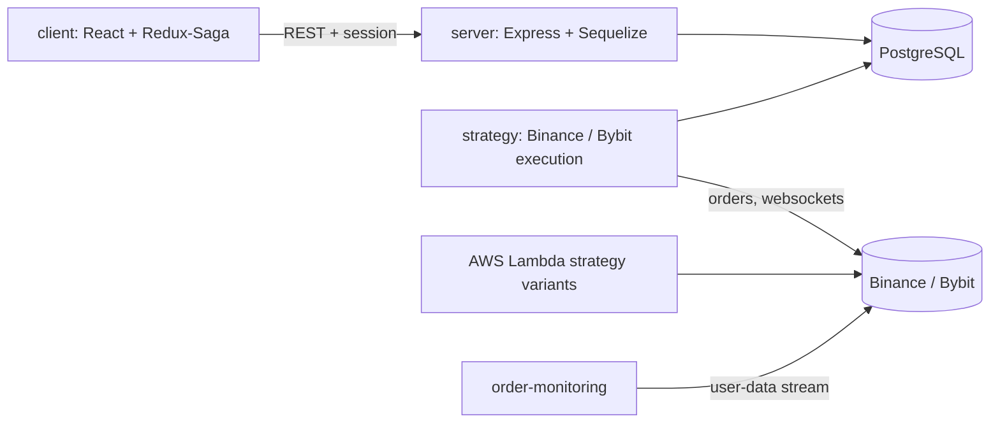

# minfifty

Full-stack crypto trading platform: a React dashboard, an Express/Sequelize API, and Binance/Bybit order-execution strategies that run on AWS Lambda and ECS.

[](https://github.com/nicolasMazuryk/minfifty/actions/workflows/ci.yml)
[](LICENSE)

## The problem

Placing a limit entry and a limit/market exit on a futures exchange, then watching the fills and reacting to them, is easy to get wrong by hand. minfifty automates the loop: a strategy places and tracks orders, the API stores users, settings and results in Postgres, and the dashboard shows the account state.

TODO(me): screenshot of the dashboard.

## Architecture



## Stack

- **client**: React 18, Redux + Redux-Saga, Material UI, SCSS modules, Jest + Testing Library
- **server**: Node, Express, Sequelize + Postgres, session auth, Jest
- **strategy**: TypeScript, `binance-api-node`, Sequelize models, backtesting scripts
- **infra**: Docker, docker-compose (Postgres), pm2, AWS ECS/ECR (GitHub Actions deploy workflow) and Lambda

## Getting started

Requires Node 18 or newer and Docker.

```bash
npm install --ignore-scripts      # installs all workspaces
cp server/.env.example server/.env
cp strategy/.env.example strategy/.env
cp client/.env.example client/.env
docker-compose up -d              # Postgres
```

Fill in the `.env` files. Exchange credentials are read from the environment only (`BINANCE_API_KEY`, `BINANCE_API_SECRET`, ...). `.env` files are gitignored; never commit them.

```bash
npm run server        # API, in watch mode
npm run client        # dashboard on http://localhost:3000
```

Checks for the client:

```bash
cd client
npm run lint
npx jest
npm run build
```

Strategy scripts (`strategy/package.json`): `npm run real-time`, `npm run backtest`, `npm run sync-market-data`.

pm2 setups live in `ecosystem.config.js` (strategy) and `strategy/order-monitoring/ecosystem.config.js` (one process per account listed in `ORDER_MONITOR_ACCOUNTS`).

## Layout

```
client/      React dashboard
server/      Express/Sequelize API, migrations, API tests
strategy/    execution strategies, backtests, AWS Lambda variants, order monitoring
.github/     CI and an ECS deploy workflow (manual trigger)
```

## Design decisions

- **Strategy code is shared.** The server and client import types from `strategy/common` through the `@common` alias.
- **Credentials come from the environment.** The code, pm2 files and workflows read keys from env vars, so nothing secret lives in the repo.
- **One process per exchange account** for order monitoring, so one account failing does not stop the others.

## Limitations and roadmap

- The price chart is a placeholder. The original version embedded a third-party charting widget that cannot be redistributed, so it was removed. A replacement based on an open-source chart library is planned.
- `server` and `strategy` have type errors under a current TypeScript toolchain (alias runtime typings, an unused variable); only the client is checked in CI.
- No lockfile is committed, so dependency versions float.
- Several Lambda variants (`strategy/aws_lambda_*`) are near-duplicates and could be folded into one parameterized handler.

## License

[MIT](LICENSE)
